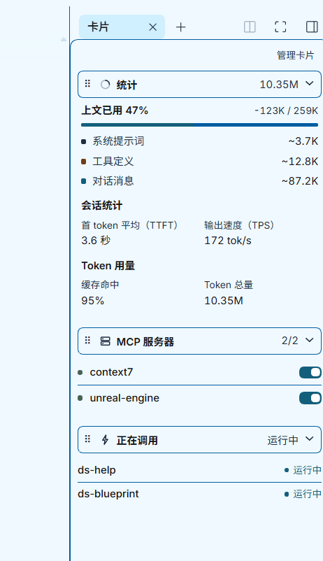

# dsh-client-ui-session-panels

一个标签页里放三张卡：**统计**、**正在调用**（技能与 MCP 调用在途）、**MCP 服务器**（连接状态 + 重连开关）。

**统计**卡按应用内上下文浮层复刻：已用占比 + 窗口条 + 三行构成图例（系统提示词 / 工具定义 / 对话消息），下面接「会话统计」（首 token 平均、输出速度）与「Token 用量」（缓存命中、Token 总量，单位 M）。卡片标题栏的摘要就是 Token 总量。



每张卡带**标题栏**（图标 + 标题 + 摘要 + 折叠箭头），**直接拖标题栏就能调顺序**。右上「管理卡片」进入整理模式：开关显隐。

## 数据从哪来

- **统计**：宿主 projection（`contextPressure`、`tokenUsage`、`sessionStats`、`contextBreakdown`）。缓存命中率 = 缓存读取 ÷（未缓存输入 + 缓存读取 + 缓存写入），公式沿自 openchamber 的 `computeCacheHitRate`。Token 总量 = 未缓存输入 + 缓存读取 + 输出，按 M 显示；图例的构成估算带 `~`。
- **正在调用**：会话事件流（`remote.session.follow`）——技能经 `/name` 或 `skill` 工具进入、轮次边界清除；MCP 调用由 `tool/call` / `tool/result` 括起，按调用生命周期显示。
- **MCP 服务器**：本插件宿主半边的同源路由，重连开关是插件里唯一改宿主状态的控件（只重启条目，不改任何配置文件）。

## 环境要求

- DSH Desktop **≥ 0.2.1-rc.3**（`package.json` 的 `dsh.engines.dsh`）。
- 构建用 Node 18 以上。

## 先构建

```bash
npm install     # 首次
npm run build   # 生成 lib/client.js、lib/index.js
npm run unit    # 11 组纯函数断言
npm run drag    # 9 组 jsdom 交互断言（捕获时机/ghost 跟手/插入侧向/点击守卫/阈值/卸载清理/会话切换）
npm run smoke   # 13 组渲染断言（不需要启动应用）
npm run typecheck
```

`lib/` 是产物，不构建就没有可加载的入口。

## 安装（只支持 GitHub）

插件以 GitHub 仓库 + tag 的形式分发（当前 **v0.2.3**）：构建产物 `lib/` 已入库，安装端不需要构建；git 依赖由 lockfile 钉死到具体 commit，应用启动时的依赖对账直接命中 pnpm store，**不会每次启动重解包**。

### 1. 装进 profile

```bash
node scripts/switch-to-git.mjs            # 默认 ~/.dsh/profiles/desktop，可 --profile 指定
```

或用应用内：侧栏**插件** → **添加插件** → 填
`https://github.com/alonewolfsy-web/dsh-client-ui-session-panels#v0.2.3`

脚本做四件事：`git ls-remote` 确认 tag 存在（不存在绝不碰 profile）→ `pnpm add github:alonewolfsy-web/dsh-client-ui-session-panels#v0.2.3` → 校验「清单 / 落盘副本 / 版本号」三层一致 → 删掉遗留的 `vendor` tgz。

> **已知误报**：插件已装好后再在 UI 里点一次安装，会报「无法从依赖变更中确定安装了哪一个包」。原因是 pnpm 看到 `Already up to date`、依赖零变更，管理器无法从前后 diff 里识别包名。这不是安装失败——升级请打新 tag 后跑 `switch:git`；要用 UI 装，先卸载再装。


## 安装后验证

- 右侧栏出现「卡片」标签页（来自向导胶囊或面板的添加控件）。
- 拖任一卡的标题栏可实时调序；轻点标题栏折叠/展开。
- 右上「管理卡片」可进入整理模式（拖拽 + 显隐开关）。
- MCP 卡有数据（若 profile 配了 MCP 服务器）。

## 卸载

侧栏**插件** → 找到 `ui-session-panels` → 停用/移除。`cordis.patch.yml` 插入的行随移除消失，不残留。

## 版本

- **v0.2.3** — 上下文卡换成应用内浮层原样版式，更名为「统计」；「Token 用量」只留缓存命中与 Token 总量（M），「会话统计」只留首 token 平均与输出速度；删除「轮次统计」卡（数据与统计卡重复）；卡片 id `context` → `gauge`，旧存档的排位保留、旧隐藏标记作废。
- **v0.2.2** — 拖拽 ghost 只克隆标题栏，落点只剩插入线，标签页标题缩为「卡片」。
- **v0.2.1** — 首个 GitHub tag 分发版本。

## 与会话卡片插件的关系

| | session-cards（会话卡片） | 本插件（右侧面板卡片插件） |
| --- | --- | --- |
| 标签页类型 | `session-cards` | `session-panels` |
| 定位 | 聚合读数卡 | 面板式分区 + 缓存分析 |
| MCP 路由 | `/session-cards/mcp` | `/session-panels/mcp` |

两者同装互不冲突；只想要一套的话选其一即可。
